# SpectrumIQ implementation plan

SpectrumIQ is scientific microscope instrument software:

- a 100 MP 14-bit CoaXPress camera;
- motorized XYZ stage and focus drive;
- live and post-acquisition stitching to 500 MP and beyond;
- depth from focus, deconvolution, optical sectioning and light field;
- one Vue frontend for the Tauri desktop app and remote browsers;
- a Rust service core built on `teta-wot`.

| Document | Contents |
|---|---|
| [../goals.md](../goals.md) | The original goals |
| [architecture.md](architecture.md) | Target architecture: processes, crates, frame path, memory, API, streaming, storage, security, frontend, simulation |
| [conventions.md](conventions.md) | **Read first for every phase:** phase protocol, definition of done, LOC accounting, documentation, coding and test standards |
| [milestones/](milestones/) | One file per milestone, holding the self-contained phase briefs |
| [../adr/](../adr/README.md) | Architecture decision records; 0001–0016 come from planning |
| [../requirements.md](../requirements.md) | Requirement IDs with traceability |
| [../soup.md](../soup.md) | Third-party components register |

## 1. How to run a phase (for Claude Code)

> "Implement phase P<m>.<n> of docs/plan."

The session then:

1. reads this file, [conventions.md](conventions.md), the brief, and the referenced ADRs and impl
   notes;
2. checks that the dependencies are **Done** below;
3. works on branch `phase/P<m>.<n>-<slug>`;
4. delivers code, tests, an example, an ADR, a README and impl notes;
5. runs `cargo xtask ci` and `cargo xtask loc --base main`;
6. updates the status here and the traceability in `requirements.md`.

The owner reviews and merges.

## 2. Decisions from planning

Decided with the owner on 2026-10-23, and recorded in ADRs 0001–0016:

| Topic | Decision | ADR |
|---|---|---|
| Process model | Separate service (`spectrumiq-server`, Windows service). Tauri and browsers are clients | 0002 |
| Server framework | teta-wot v0.1.0 (git tag), unmodified. Auth, control token, tiles and streams are built in SpectrumIQ. Things at `/api/v1/`, own routes at `/api/siq/` | 0003 |
| Euresys | C++ shim + bindgen over the installed eGrabber 25.02. Pre-generated bindings. No SDK files in the repo | 0004 |
| Workstation | Fixed and already working: mini-ITX, AMD, 32 GB RAM, RTX 3060 8 GB → streaming and out-of-core everywhere | 0005, 0016 |
| Camera | Mono16, with ROI/binning modes at higher fps | 0016 |
| Motion | GRBL/grblHAL XYZ (stage Z = coarse). A separate focus drive with documented ASCII protocol does the fine Z: z-stacks, autofocus, focus maps | 0016 |
| Peripherals | Illumination, filter wheel, turret, light-field/confocal/SIM unit: traits + simulators now, drivers later | 0016 |
| Imaging | Mixed / general purpose → a channel axis everywhere | 0014 |
| Scanning | Stop-and-go first. Continuous hardware-triggered scanning gets a design ADR later | 0013 |
| Formats | OME-Zarr master; raw + JSON scratch; OME-TIFF export; DZI (on demand + export) | 0006 |
| Recording | Only selected frames. No continuous 1.8 GB/s recording | 0006 |
| Algorithms | Pure Rust + wgpu. Native code only by ADR | 0007 |
| Stitching | Translation-only + global calibration; phase correlation; weighted LS pose graph; shading from calibration frames **and** retrospectively | 0013 |
| 3D | DFF, deconvolution, sectioning and light field, all in scope. Light-field geometry and sectioning hardware are undecided, hence pluggable traits | 0014 |
| Frontend | Vue 3 + Vite + TS + Pinia. **`microscope`'s components on Reka UI, skinned with its tokens** (PrimeVue was planned, but version 5 is no longer MIT: ADR-0008, amended). `microscope@0640f99`'s web app is copied and adapted. `microscope`'s backend is not reused | 0008 |
| 2D viewer | OpenSeadragon with server LUT tiles first; WebGL2 16-bit renderer later | 0009 |
| 3D viewer | VTK.js; native winit+wgpu viewer later (optional) | 0009 |
| Live streams | MJPEG overview + native-resolution ROI first; H.264 (Media Foundation / NVENC) later; WS observations for the connection budget | 0010 |
| Local fast path | Staged: loopback → direct tiles → WebView2 shared memory, each gated by a benchmark | 0010 |
| Network | Lab LAN only | 0011 |
| Auth | Local accounts + roles (Viewer, Operator, Admin), Hardware Control Token, hash-chained audit | 0011 |
| Simulation | Protocol emulators + image-formation camera + procedural/real-image worlds with ground truth | 0012 |
| Workflows | Tile scan + focus map, z-stack, multi-position, time-lapse, scripting over HTTP (Python examples) | — |
| Compliance | Research use now; medical/IVD later, so traceability, SOUP and audit are kept from the start | 0001 |
| Executor | Claude Code, one phase per session; self-contained briefs | 0015 |
| Phase size | < 1000 production lines, all languages combined | 0015 |
| Priority | 2D pipeline first, then multi-client, then hardware bring-up, then 3D | — |
| Licence | Open source (MIT); permissive dependencies only | 0007 |
| CI | Local only for now (`cargo xtask ci`) | 0015 |

### Interpretations of the goals

These points of [goals.md](../goals.md) are read as follows:

- **"wgpu (CPU compute shaders)"** means GPU compute shaders.
- **"Preview at 30–60 FPS":** full-frame previews run at the camera's ~9 fps, and ROI/binning modes
  run faster. Pan and zoom render at display rate in the browser.
- **The Tauri IPC bottleneck** doesn't arise: no image data crosses Tauri IPC (ADR-0002).
- **"DZI on disk":** tiles are rendered on demand from OME-Zarr, so the LUT can be changed live.
  Static DZI export to disk is also available.
- **VTK.js for deep-zoom tiles:** 2D tiles use OpenSeadragon; VTK.js is for 3D.
  **Three.js / Babylon.js** are not used.
- **SIFT/SURF:** phase correlation is primary. An optional pure-Rust ORB-like fallback exists
  (SURF is patented).
- **"Bundle adjustment / pose graph":** a translation-only weighted pose graph, because the
  calibration supplies rotation, scale and shear.
- **NVENC/QuickSync:** reached through Windows Media Foundation hardware encoders (later).
  **WebRTC** is not planned on a LAN.

## 3. Roadmap

```mermaid
flowchart LR
  M0[M0 Foundations] --> M1[M1 Memory, devices, simulation]
  M1 --> M2[M2 Acquisition, preview, server]
  M2 --> M3[M3 Frontend foundations]
  M2 --> M4[M4 Storage, jobs, 2D viewer]
  M3 --> M4
  M4 --> M5[M5 Registration, calibration]
  M5 --> M6[M6 Workflows]
  M6 --> M7[M7 Live stitching]
  M6 --> M8[M8 Post stitching]
  M7 --> M8
  M8 --> M9[M9 Multi-client, security]
  M9 --> M10[M10 Hardware bring-up]
  M10 --> M11[M11 DFF]
  M11 --> M12[M12 Deconvolution, sectioning]
  M12 --> M13[M13 Light field]
  M9 --> M14[M14 Streaming, fast paths, advanced viewers]
  M12 --> M14
  M13 --> M15[M15 Production readiness]
  M14 --> M15
```

There are 88 phases in total: 86 planned, and P0.3 and P1.10 each split in two. The optional,
stretch and gated phases are P8.6, P10.4, P13.4 and
P14.4–P14.5. P10.5 repeats once per peripheral.

**Status values:**

- `—` not started;
- `WIP`;
- `Review`;
- `Done`.

A phase is Done once it is merged.

### M0 — Foundations ([brief](milestones/M00-foundations.md))

| Phase | Title | Budget | Depends on | Status |
|---|---|---|---|---|
| P0.1 | Workspace, toolchain, xtask and templates | 600 | — | Done |
| P0.2 | Domain types (`siq-types`) | 800 | P0.1 | Done |
| P0.3a | Telemetry (split from P0.3) | 300 | P0.2 | Done |
| P0.3b | Instrument configuration (split from P0.3) | 800 | P0.3a | Done |

### M1 — Frame memory, devices and simulation ([brief](milestones/M01-memory-devices-simulation.md))

| Phase | Title | Budget | Depends on | Status |
|---|---|---|---|---|
| P1.1 | Frame pool | 800 | P0.2 | Done |
| P1.2 | Frame fan-out | 600 | P1.1 | Done |
| P1.3 | Device traits | 700 | P1.1 | Done |
| P1.4 | Synthetic specimen worlds | 900 | P0.2 | Done |
| P1.5 | CPU image kernels | 850 | P0.2 | Done |
| P1.6 | Image formation model | 800 | P1.4, P1.5 | Done |
| P1.7 | Simulated camera device | 600 | P1.2, P1.3, P1.6 | Done |
| P1.8 | Serial transport and GRBL emulator | 850 | P1.7 | Done |
| P1.9 | GRBL stage driver | 800 | P1.3, P1.8 | Done |
| P1.10a | ASCII dialects and the dialect emulator (split from P1.10) | 700 | P1.3, P1.8 | Done |
| P1.10b | ASCII focus driver and peripheral simulators (split from P1.10) | 650 | P1.10a | Done |

### M2 — Acquisition, live preview and the first server ([brief](milestones/M02-acquisition-preview-server.md))

| Phase | Title | Budget | Depends on | Status |
|---|---|---|---|---|
| P2.1 | Acquisition engine | 800 | P1.2, P1.3, P1.7 | Done |
| P2.2 | Preview pipelines | 700 | P1.5, P2.1 | Done |
| P2.3 | Service core: camera, display, stage, focus Things | 900 | P0.3b, P1.9, P1.10b, P2.2 | Done |
| P2.4 | Peripherals, channels and system routes | 600 | P2.3 | Done |
| P2.5 | Euresys shim and bindings (risk spike) | 700 | P0.1 | Done |

### M3 — Frontend foundations ([brief](milestones/M03-frontend-foundations.md))

| Phase | Title | Budget | Depends on | Status |
|---|---|---|---|---|
| P3.1 | Import the microscope web app (Reka UI kept: ADR-0008, amended) | 800 | P2.3 | Done |
| P3.2 | API client: WS observations, connection budget, stores | 800 | P3.1 | Done |
| P3.3 | Live view | 850 | P3.2 | Done |
| P3.4 | Stage, focus and peripheral control | 800 | P3.3 | Done |
| P3.5 | Tauri desktop shell | 600 | P3.2 | Done |

### M4 — Storage, jobs and the 2D deep-zoom viewer ([brief](milestones/M04-storage-jobs-viewer.md))

| Phase | Title | Budget | Depends on | Status |
|---|---|---|---|---|
| P4.1 | Datasets and raw scratch writer | 800 | P2.1 | Done |
| P4.2 | OME-Zarr I/O | 850 | P4.1 | Done |
| P4.3 | Job system | 850 | P0.3b, P4.1 | Done |
| P4.4 | Pyramid builder | 600 | P4.2, P4.3 | Done |
| P4.5 | Tile service and DZI | 850 | P4.4, P2.3 | Done |
| P4.6 | OME-TIFF export | 800 | P4.4 | Done |
| P4.7 | `datasets` Thing and processing on snap | 700 | P4.3–P4.5 | Done |
| P4.8 | Dataset browser and 2D viewer UI | 900 | P4.7, P3.2 | Done |
| P4.9 | Synthetic dataset generator | 700 | P1.6, P4.1 | Done |

### M5 — Registration and calibration ([brief](milestones/M05-registration-calibration.md))

| Phase | Title | Budget | Depends on | Status |
|---|---|---|---|---|
| P5.1 | Phase correlation | 800 | P1.5 | Done |
| P5.2 | Stage–camera calibration | 800 | P5.1, P2.4 | Done |
| P5.3 | Shading correction | 850 | P5.2, P4.3 | Review |
| P5.4 | Calibration UI | 800 | P5.2, P5.3, P3.4 | — |

### M6 — Workflows ([brief](milestones/M06-workflows.md))

| Phase | Title | Budget | Depends on | Status |
|---|---|---|---|---|
| P6.1 | Workflow engine | 850 | P2.4, P4.1, P5.2 | — |
| P6.2 | Tile scan planner and step | 750 | P6.1 | — |
| P6.3 | Autofocus and focus maps | 800 | P6.1 | — |
| P6.4 | Z-stacks, multi-position, time-lapse | 700 | P6.2, P6.3 | — |
| P6.5 | `workflow` Thing, saved positions, scripting | 600 | P6.4 | — |
| P6.6 | Scan setup UI | 900 | P6.5, P5.4 | — |
| P6.7 | Run monitor and sequence UI | 700 | P6.6 | — |

### M7 — Real-time live stitching ([brief](milestones/M07-live-stitching.md))

| Phase | Title | Budget | Depends on | Status |
|---|---|---|---|---|
| P7.1 | GPU foundation | 800 | P0.3b | — |
| P7.2 | Live mosaic canvas | 900 | P7.1, P5.2, P5.3 | — |
| P7.3 | Viewport rendering and `mosaic_live` Thing | 700 | P7.2, P2.3 | — |
| P7.4 | Live mosaic UI | 700 | P7.3, P6.6 | — |

### M8 — Post-acquisition stitching ([brief](milestones/M08-post-stitching.md))

| Phase | Title | Budget | Depends on | Status |
|---|---|---|---|---|
| P8.1 | Overlap graph and pairwise registration | 750 | P5.1, P5.3, P4.3 | — |
| P8.2 | Global alignment | 700 | P8.1 | — |
| P8.3 | Out-of-core compositing | 850 | P8.2, P4.2, P4.4 | — |
| P8.4 | Stitch job, auto-stitch and QA UI | 800 | P8.3, P6.5, P4.8 | — |
| P8.5 | Ground-truth validation and benchmarks | 400 | P8.4, P4.9 | — |
| P8.6 | (Optional) Feature-based fallback | 850 | P8.5 | — |

### M9 — Multi-client, accounts, control token and audit ([brief](milestones/M09-multi-client-security.md))

| Phase | Title | Budget | Depends on | Status |
|---|---|---|---|---|
| P9.1 | Accounts and sessions | 850 | P2.3 | — |
| P9.2 | Authorization layer and Hardware Control Token | 850 | P9.1, P6.5 | — |
| P9.3 | Audit trail | 600 | P9.2 | — |
| P9.4 | Frontend: login, roles, control token, admin | 900 | P9.2, P9.3, P3.5 | — |
| P9.5 | End-to-end tests and soak tool | 500 | P9.4 | — |

### M10 — Hardware bring-up ([brief](milestones/M10-hardware-bringup.md))

| Phase | Title | Budget | Depends on | Status |
|---|---|---|---|---|
| P10.1 | Euresys safe wrapper and `Camera` implementation | 900 | P2.5, P1.1, P1.3 | — |
| P10.2 | Camera bring-up and performance tuning | 500 | P10.1 | — |
| P10.3 | Real stage and focus drive bring-up | 500 | P1.9, P1.10b, P5.1 | — |
| P10.4 | (Optional) Hardware trigger and strobe | 600 | P10.2 | — |
| P10.5 | Peripheral drivers (one phase per device) | ≤ 900 each | P1.10b | — |

### M11 — 3D: depth from focus ([brief](milestones/M11-depth-from-focus.md))

| Phase | Title | Budget | Depends on | Status |
|---|---|---|---|---|
| P11.1 | DFF core on the CPU | 800 | P1.5, P4.9 | — |
| P11.2 | DFF on the GPU | 700 | P11.1, P7.1 | — |
| P11.3 | DFF workflow, live DFF, outputs | 700 | P11.2, P6.4, P8.4 | — |
| P11.4 | 3D viewer foundation with VTK.js | 900 | P11.3, P4.8 | — |

### M12 — 3D: deconvolution and optical sectioning ([brief](milestones/M12-deconvolution-sectioning.md))

| Phase | Title | Budget | Depends on | Status |
|---|---|---|---|---|
| P12.1 | PSF models | 700 | P0.2 | — |
| P12.2 | CPU Richardson–Lucy deconvolution | 850 | P12.1, P4.2, P4.3 | — |
| P12.3 | GPU FFT and GPU Richardson–Lucy | 950 | P12.2, P7.1 | — |
| P12.4 | Optical sectioning reconstructors | 800 | P12.2, P4.9, P6.4 | — |
| P12.5 | Volume viewer (VTK.js) | 950 | P11.4, P12.2 | — |

### M13 — 3D: light field ([brief](milestones/M13-light-field.md))

| Phase | Title | Budget | Depends on | Status |
|---|---|---|---|---|
| P13.1 | Light-field model, MLA calibration, synthetic light fields | 900 | P1.4, P4.9, P5.1 | — |
| P13.2 | Sub-aperture views, refocusing, depth | 900 | P13.1, P11.1 | — |
| P13.3 | Light-field workflow, outputs and UI | 900 | P13.2, P11.4 | — |
| P13.4 | (Stretch) 3D light-field deconvolution | 950 | P13.3, P12.3 | — |

### M14 — Streaming upgrades, local fast paths, advanced viewers ([brief](milestones/M14-performance-advanced-viewers.md))

| Phase | Title | Budget | Depends on | Status |
|---|---|---|---|---|
| P14.1 | 16-bit tile renderer (WebGL2) | 950 | P4.8 | — |
| P14.2 | Multiplexed binary stream | 700 | P9.2 | — |
| P14.3 | H.264 encoding and WebCodecs playback | 850 | P14.2 | — |
| P14.4 | (Gated) Desktop direct tile reads | 500 | P3.5, P4.5 | — |
| P14.5 | (Gated) Shared-memory live frames | 900 | P14.2, P3.5 | — |
| P14.6 | Native 3D viewer: bricked volumes | 800 | P12.5, P7.1 | — |
| P14.7 | Native 3D viewer: ray casting | 900 | P14.6 | — |

### M15 — Production readiness ([brief](milestones/M15-production-readiness.md))

| Phase | Title | Budget | Depends on | Status |
|---|---|---|---|---|
| P15.1 | Windows service and installer | 600 | P3.5, P9.2 | — |
| P15.2 | Fault tolerance and safe states | 800 | P10.3, P6.5 | — |
| P15.3 | Documentation and traceability tooling | 500 | all functional | — |

## 4. Possible reorderings

- **P2.5 (Euresys spike)** depends only on P0.1, so it can run at any time. Running it early
  reduces risk.
- **M10** can move ahead of M9 if hardware access matters more than multi-client. P10.1 needs only
  P2.5, P1.1 and P1.3.
- **M7 (live stitching)** and **M8 (post stitching)** are independent once M6 is done. Either can
  come first.
- **P12.1 (PSF models)** and **P7.1 (GPU foundation)** have few dependencies, and can fill gaps.

## 5. Risks

| # | Risk | Mitigation | Where |
|---|---|---|---|
| R1 | eGrabber user-memory announcement conflicts with locked pool memory, or slot alignment needs | Early spike; Playlink; the pool supports either allocation style | P2.5, P10.1 |
| R2 | The simulated camera can't render 100 MP at 9 fps | Noiseless-render cache when stationary; `fast` profile; GPU rendering as a follow-up | P1.6 |
| R3 | 32 GB RAM pressure (locked pool + jobs + WebView2) | Admission control, out-of-core design, memory tests | ADR-0005, P4.3 |
| R4 | wgpu binding-size and texture limits for 100 MP buffers | Banding/paging; request adapter limits | P7.1, P11.2 |
| R5 | Browser 6-connection limit (HTTP/1.1) | WS observations, stream budget, binary multiplex later | ADR-0010, P3.2, P9.5 |
| R6 | GRBL status latency and jitter, plus open-loop error | Stop-and-go; paint only stationary frames in live stitching; global alignment | ADR-0013 |
| R7 | NGFF 0.5 not readable by a target tool | Fall back to 0.4; OME-TIFF export | P4.2 |
| R8 | Keeping the `microscope` look, and widgets Reka UI lacks (data tables, trees) | `microscope`'s wrappers kept; new ones on TanStack Table and Reka UI's Tree; galleries; both-theme review | P3.1, M9 |
| R9 | Mini-ITX PCIe lanes shared by GPU and grabber limit DMA throughput | Measure DMA throughput at bring-up; 1.8 GB/s needs about PCIe 3.0 x4 | P10.2 |
| R10 | GPU FFT complexity | CPU reference first; equivalence tests | P12.2, P12.3 |
| R11 | No libclang on the build machine | Pre-generated, committed bindings | P2.5 |
| R12 | Scope (86 phases) | Optional and gated phases marked; milestones deliver usable increments | §3 |

## 6. Open questions

These are needed later; none of them blocks M0–M2.

1. **Camera model:** exact resolution, GenICam feature names for ROI and binning, trigger and strobe
   capabilities, and whether the camera is connected to this development PC. Needed by P2.5 and
   P10.1.
   - **Found in P2.5:** an Adimec D-103A12c/CXP-T01 is connected to this PC, at 11264 × 9200
     (103.6 MP) in `BayerGB8`.
   - It is a colour camera, so whether it is the instrument's camera, and REQ-ACQ-001's 14-bit
     mono, are now open (P2.5 notes).
2. **Coaxlink model and slot:** for example, Quad CXP-12, and the PCIe lanes it gets on the
   mini-ITX board. Needed by P10.2.
   - **Found in P2.5:** a Coaxlink Quad CXP-12 (`PC3603`, 1-camera firmware). The PCIe lanes
     are still to be measured.
3. **Focus drive:** vendor, model, and the protocol document. Needed by P10.3.
4. **GRBL controller:** board, firmware version, homing switches, travel, steps/mm, and any
   encoders. Needed by P10.3.
5. **Peripheral models:** illumination, filter wheel, turret, and modality unit. Needed by P10.5.
6. **Workstation details:** AMD CPU model (core count) and NVMe model (sustained write speed).
   Needed by P2.2 and P4.1 performance targets.
7. **3D hardware:** the light-field geometry (conventional or Fourier) and the sectioning hardware
   (spinning disk or SIM/HiLo). Needed by M12 and M13.
8. **Real specimen images** to use as `ImageWorld` inputs. Needed by P1.4, optional.
9. **Sync with `microscope`:** should SpectrumIQ periodically re-sync the copied frontend from
   `microscope`, or diverge permanently after P3.1?
10. **The JPEG encoder's licence:** decided in P1.8. IJG is allowed with its attribution, and
    MPL-2.0 for unmodified dependencies such as `serialport` (ADR-0028).
