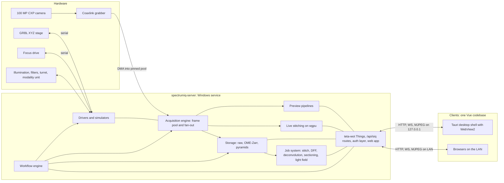
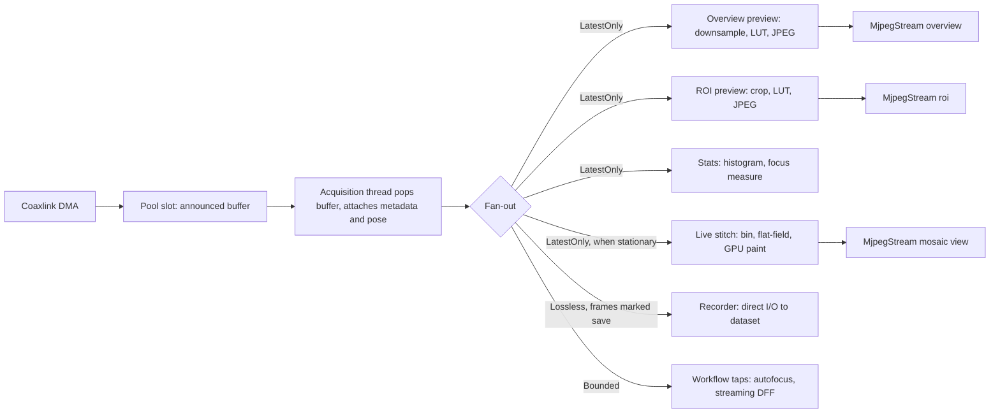
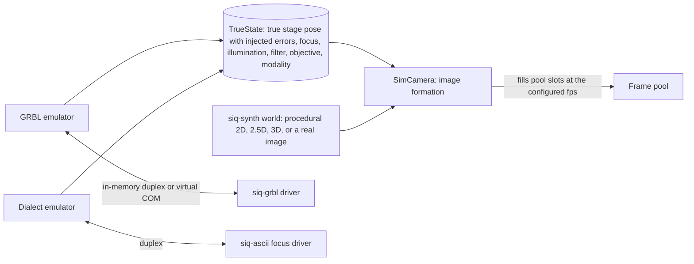

# SpectrumIQ architecture

This is the target architecture that the milestones build toward. Decisions already taken are
recorded as ADRs 0001–0016 in [../adr/](../adr/README.md). Phases refine them with their own ADRs.

## 1. Context and constraints

| Item | Value | Consequence |
|---|---|---|
| Camera | ~100 MP, 14-bit mono in Mono16 words; ROI/binning modes with higher fps | 200 MB/frame. Full frame at ~9 fps = **1.8 GB/s** |
| Grabber | Euresys Coaxlink (CoaXPress), eGrabber 25.02 installed at `C:\Program Files\Euresys\eGrabber` | C++ shim + bindgen (ADR-0004) |
| XYZ stage | GRBL / grblHAL G-code over serial, open-loop | Stage Z is coarse; positions are commanded, not measured |
| Focus drive | Separate, documented ASCII serial protocol | Fine Z: z-stacks, autofocus, focus maps |
| Peripherals | Illumination, filter wheel, objective turret, LF/confocal/SIM modality unit | Models unknown: traits + simulators now (ADR-0016) |
| Workstation (fixed) | Mini-ITX, AMD CPU, **32 GB RAM**, **RTX 3060 8 GB**, NVMe | Out-of-core, streaming algorithms everywhere (ADR-0005) |
| OS | Windows 11 x64 only | MSVC toolchain, Windows service, WebView2 |
| Network | Lab LAN only | Plain HTTP acceptable; browsers allow **6 HTTP/1.1 connections per origin** (§7.3) |
| Scale | Mosaics ≥ 500 MP (1 GB per channel per plane at u16); z-stacks of 50+ slices (10 GB+) | Nothing assumes a dataset fits in RAM |
| Compliance | Research use now, medical/IVD possibly later | Traceability, SOUP register, audit trail, risk notes (ADR-0001) |

## 2. System overview



- **The core is a separate process** (ADR-0002). `spectrumiq-server` runs as a Windows service, or as
  a console process during development. Acquisition never depends on a UI process staying alive.
- **Clients are equal.** The Tauri app is a native shell around the same web app that browsers load
  from the server. It adds only host services (`HostAdapter`: file dialogs, local login, launching
  the native 3D viewer, and later the local fast paths).
- **Raw 14-bit pixels never cross the UI boundary in live operation.** Clients receive:
  - compressed previews;
  - rendered tiles;
  - reduced 3D data;
  - analysis results.

  Full-resolution data leaves the server only as an explicit export or download.

## 3. Crate architecture

### 3.1 Layers

| Layer | Crates | May depend on |
|---|---|---|
| L0 Foundation | `siq-types` (units, coordinates, frame metadata, image views, clock), `siq-config`, `siq-telemetry` | L0 |
| L1 Core libraries: sync, no devices, no tokio | `siq-buffer` (frame pool, fan-out), `siq-imgproc` (CPU kernels), `siq-gpu` (wgpu infra, GPU FFT), `siq-synth` (synthetic specimens and ground truth), `siq-storage` (datasets, raw, OME-Zarr, OME-TIFF), `siq-register` (phase correlation), `siq-mfenc` (H.264, M14), `siq-shm` (shared memory, M14) | L0, L1 |
| L2 Devices | `siq-devices` (traits and mocks), `siq-serial`, `siq-grbl`, `siq-ascii` (dialect driver), `siq-euresys-sys`, `siq-euresys`, `siq-sim` (camera image formation, protocol emulators, peripheral sims) | L0–L2 |
| L3 Processing: pure algorithms, sync, rayon/wgpu | `siq-pyramid`, `siq-calib`, `siq-stitch-live`, `siq-stitch`, `siq-dff`, `siq-deconv`, `siq-section`, `siq-lightfield` | L0, L1, L3 (never L2) |
| L4 Engines: async orchestration | `siq-acquire`, `siq-preview`, `siq-jobs`, `siq-workflow` (incl. autofocus, focus map, calibration routines), `siq-auth` | L0–L4 |
| L5 Service | `siq-server`: Things, routes, middleware, web app hosting. **The only crate that depends on teta-wot.** | all |
| Apps | `spectrumiq-server`, `spectrumiq-desktop` (Tauri), `siq-datagen`, `spectrumiq-viewer3d` (late) | anything; nothing depends on an app |

Rules:

1. L3 never depends on devices, tokio or teta-wot. Every algorithm runs offline on datasets, in
   tests, and in `siq-datagen` validation.
2. Engines (L4) depend on device **traits** (`siq-devices`), never on concrete drivers. Concrete
   drivers are selected in `siq-server` from configuration (sim or real, per device).
3. `cargo xtask layers` checks the table and rule 1 with `cargo metadata`, against the table in
   `xtask/src/layers.rs`.
   - Normal and build dependencies are checked.
   - Dev-dependencies are exempt, so tests may use simulators to make data.
   - A crate missing from the table fails the check.

   Review enforces rule 2 (ADR-0017).

### 3.2 Crate map (milestone introducing it)

```
siq-types M0   siq-config M0   siq-telemetry M0
siq-buffer M1  siq-devices M1  siq-serial M1  siq-grbl M1  siq-ascii M1  siq-synth M1  siq-sim M1
siq-imgproc M1 siq-acquire M2  siq-preview M2 siq-server M2 siq-euresys-sys M2
siq-storage M4 siq-jobs M4     siq-pyramid M4
siq-register M5 siq-calib M5   siq-workflow M5 (routines; engine in M6)
siq-gpu M7     siq-stitch-live M7
siq-stitch M8
siq-auth M9
siq-euresys M10
siq-dff M11    siq-deconv M12  siq-section M12  siq-lightfield M13
siq-mfenc M14  siq-shm M14
```

## 4. The frame path (data plane)

### 4.1 Flow



- **The pool is the ring buffer** (ADR-0005, P1.1).
  - N slots (default 12 × 200 MB = 2.4 GB) are allocated once, page-aligned with `VirtualAlloc`,
    and locked with `VirtualLock` after raising the working-set minimum.
  - With eGrabber, each slot is announced as user memory (`announceAndQueue(UserMemory)`), so the
    grabber DMAs straight into it.
  - With the simulator, a render thread fills free slots.
- **Leases.** A popped buffer becomes a `FrameLease` (slot, `FrameMeta`), reference-counted across
  consumers. When the last lease drops, the slot is re-queued to the producer (the grabber).
  Nothing is allocated or copied on the steady-state path.
- **Consumer policies:**
  - `LatestOnly`: preview and stats. They never hold more than one frame and skip frames when
    slow.
  - `Bounded(n)`: workflow taps.
  - `Lossless`: the recorder, only for frames marked "save". Backpressure here means the grabber
    runs out of free buffers. Frames are then lost at the grabber, and counted and reported
    (REQ-ACQ-005).
- **Pose association** (P2.1). Stop-and-go frames take the settled pose. Live frames take the pose
  interpolated from the stage's status timeline at mid-exposure, plus a `moving` flag and an
  uncertainty. Live stitching paints only frames that are stationary or slow.

### 4.2 Per-frame budget at 9 fps (111 ms)

| Consumer | Work | Target |
|---|---|---|
| Overview | area-average 100 MP → ≤1920×1080, LUT, JPEG q≈85 | ≤ 35 ms CPU (rayon) |
| ROI | crop ≤1920×1080 at 1:1 or 2:1, LUT, JPEG | ≤ 15 ms |
| Stats | histogram on a strided subsample; focus measure on ROI | ≤ 10 ms |
| Live stitch | 2×2 bin + flat-field (CPU) → 50 MB upload → paint | ≤ 60 ms, every other frame if needed |
| Recorder | 200 MB unbuffered write (only when saving) | NVMe-bound, ~100 ms at 2 GB/s |

Memory bandwidth is the shared limit: each 200 MB pass costs about 5–10 ms. P2.2 may later merge the
overview, stats and binning passes into one read of the frame.

### 4.3 Threads

| Thread / pool | Count | Priority | Role |
|---|---|---|---|
| Acquisition | 1 per camera | `THREAD_PRIORITY_TIME_CRITICAL` (P10.2) | `pop(timeout)`, metadata, fan-out publish |
| Frame-path rayon pool | ~half the cores | normal | preview, stats, binning |
| Recorder | 1 | above normal | unbuffered writes |
| GPU submit | 1 | normal | owns the wgpu `Device`/`Queue`; jobs and live stitch submit through a channel |
| tokio runtime | default | normal | HTTP, WS, serial I/O, workflows, timers |
| Jobs rayon pool | remaining cores | below normal | stitching, pyramids, 3D reconstruction |
| Serial | tokio tasks | — | GRBL status polling, focus drive |

## 5. Memory budget (32 GB RAM, 8 GB VRAM)

| Consumer | RAM | VRAM |
|---|---|---|
| OS, desktop, WebView2 | ~6 GB | ~0.5 GB |
| Frame pool, locked (config 8–16 slots) | 2.4 GB | — |
| Preview, stats, live-stitch staging | 0.5 GB | 0.1 GB |
| Live mosaic canvas (pages, canvas scale ½ by default) | — | ≤ 3 GB |
| Server tile cache (LRU, bytes) | 1 GB | — |
| Jobs, admission-controlled (P4.3) | ≤ 14 GB | ≤ 4 GB |
| OS page cache for memmapped raw and Zarr I/O | remaining ~8 GB | — |

- **Jobs declare their estimated peak RAM and VRAM.** The scheduler admits a job only within the
  budget. Algorithms are written as streaming or blockwise from the start:
  - DFF keeps running maps (~2 GB at 100 MP), not the stack;
  - deconvolution works on overlapping 3D blocks;
  - compositing works per output chunk;
  - pyramids are built level by level.
- **Configuration** (`[memory]` in the instrument config) sets these numbers, and `/api/siq/system`
  reports usage.

## 6. Control plane: Things and routes

### 6.1 Things (teta-wot, under `/api/v1/`)

| Thing | Key properties (observed) | Actions | Events, streams |
|---|---|---|---|
| `camera` | `exposure_ms`, `roi`, `binning`, `pixel_format`, `frame_rate`, `sensor`, `stats` (acquired/lost) | `start_live`, `stop_live`, `snap` | streams `overview`, `roi`; event `frames_lost` |
| `display` | `lut` (min, max, gamma, auto), `roi_region`, `histogram`, `focus_measure` | `auto_contrast_once` | — |
| `stage` | `position`, `state`, `limits`, `speed` | `move_to`, `move_by`, `jog`, `home`, `stop` | `arrived`, `alarm` |
| `focus` | `position`, `state`, `limits` | `move_to`, `move_by`, `stop` | `arrived` |
| `illumination`, `filter_wheel`, `objective`, `modality` | state of each | `set_*` / `select` | `changed` |
| `imaging` | `channel`, `channels` (illumination + filter + exposure + display colour) | `select_channel` | `channel_changed` |
| `mosaic_live` | `viewport`, `bounds`, `enabled`, `canvas_scale` | `clear`, `save_snapshot` | stream `view` |
| `workflow` | `state`, `progress`, `plan` | `tile_scan`, `z_stack`, `multi_position`, `time_lapse`, `pause`, `resume` | `tile_acquired`, `finished` |
| `calibration` | `status` per objective × channel | `stage_camera`, `capture_dark`, `capture_flat`, `estimate_shading` | — |
| `datasets` | `summary` | `snap_to_dataset`, `export_ome_tiff`, `export_dzi`, `delete` | `created` |
| `jobs` | `queue`, `running` | `stitch`, `build_pyramid`, `dff`, `deconvolve`, `section`, `lightfield`, `cancel` | `job_finished` |
| `control` | `holder`, `since` | `request`, `release`, `take_over` | `changed` |

- **Long operations are teta-wot invocations.** They come with cancellation (HTTP `DELETE`), logs
  and status.
- **The global lock is enabled.** Hardware actions take it. Read-only and processing affordances opt
  out (`global_lock = false`). A running workflow holds it for its whole duration, so a manual stage
  move during a scan is refused (`GlobalLockBusy` → "instrument busy" in the UI).
- **`stage.stop` and `focus.stop` bypass the lock** (REQ-SEC-004).
- **Thing code is thin.** It adapts engines from L4 and holds no algorithms.

### 6.2 SpectrumIQ routes (axum, merged with `ThingServer::router()`)

| Route | Purpose |
|---|---|
| `/`, `/assets/…` | Web app (embedded with `rust-embed` in release builds, from disk in debug builds) |
| `/api/siq/auth/{login,logout,me,local}` | Sessions (P9.1) |
| `/api/siq/users…`, `/api/siq/audit…` | Admin (P9.1, P9.3) |
| `/api/siq/data/{dataset}/dzi/{channel}/{plane}.dzi` and `…_files/{level}/{col}_{row}.{jpg,png}?min&max&gamma&cmap` | Deep-zoom tiles rendered on demand from OME-Zarr (P4.5) |
| `/api/siq/data/{dataset}/value?x&y&c&z&level` | Pixel probe (true 16-bit values) |
| `/api/siq/data/{dataset}/heightmap`, `…/volume`, `…/points` | Reduced 3D payloads for VTK.js (binary, P11.4, P12.5) |
| `/api/siq/data/{dataset}/raw16/{level}/{col}_{row}` | 16-bit tiles for the WebGL2 renderer (P14.1) |
| `/api/siq/system/{health,metrics,memory}` | Health and metrics |
| `/api/siq/stream` (WS, binary) | Multiplexed JPEG frames (P14.2), then H.264 (P14.3) |

## 7. Streaming tiers (REQ-PRV, REQ-NET)

### 7.1 Live

| Stream | v1 | Later |
|---|---|---|
| Overview ≤1080p | MJPEG (teta-wot `MjpegStream`), server-side LUT | Multiplexed binary WS (P14.2); H.264 via the Media Foundation hardware MFT (NVENC on the RTX 3060), decoded with WebCodecs (P14.3) |
| ROI at 1:1 or 2:1 | MJPEG | same |
| Live mosaic viewport | MJPEG of a server-rendered viewport (client sets `viewport`) | same |

The viewport rendering is server-side: the client sends where it is looking, and the server renders
only that part of the GPU canvas into a 1080p image. Bandwidth stays constant whatever the mosaic
size.

### 7.2 Inspection

- **2D:** OpenSeadragon requests DZI tiles over HTTP. The server renders them from OME-Zarr levels
  with the requested LUT, and caches them (P4.5).
  - Multi-channel images are layered tiled images with additive compositing.
  - Later, a WebGL2 renderer draws 16-bit tiles with client-side window/level (P14.1).
- **3D:** VTK.js fetches reduced binary payloads: height-map grids, downsampled volumes or ROIs, and
  point clouds. Isosurfaces are computed client-side first.

### 7.3 Browser connection budget (important)

`teta-wot` serves HTTP/1.1 only, and browsers open at most **6 connections per origin** over plain
HTTP. Each MJPEG stream or SSE stream holds one connection for as long as it runs. `microscope`
already hit this limit (its ADR-0024), and SpectrumIQ has many more Things. Rules (ADR-0010,
verified in P3.2):

1. **Observations go over WebSocket,** one per Thing (`/api/v1/{thing}/ws`, `addPropertyObservation`
   / `addEventSubscription`). Browsers don't count WebSockets against the 6-connection HTTP pool.
   P3.2 extends the copied `microscope` client, which ignores WS forms, with this transport.
   Fetch-SSE stays as a fallback.
2. **At most 3 MJPEG streams are open at a time.** Streams in hidden views are closed. Tiles and API
   calls get the remaining 3 or more connections.
3. **In M14,** the multiplexed binary WS carries all live frames in one connection.
4. **Optionally,** TLS through a reverse proxy enables HTTP/2 and removes the limit.

### 7.4 Local fast path for the desktop (staged, ADR-0010)

- **v1:** loopback HTTP and WS, like any browser.
- **v2 (P14.4):** the Tauri shell reads pre-rendered DZI tiles straight from the data folder through
  a custom protocol.
- **v3 (P14.5):** live frames go through named shared memory that the service publishes. Tauri
  hands them to the page as WebView2 `SharedBuffer` ArrayBuffers, which is true zero-copy.

v2 and v3 are each gated by a benchmark that must show a real gain over loopback.

**Tauri IPC never carries image data,** so the JSON-serialisation bottleneck named in the goals does
not arise.

## 8. Storage

### 8.1 Dataset layout (P4.1)

```
<data_root>/datasets/<yyyymmdd-hhmmss>_<slug>_<id8>/
  manifest.json      id, kind, created, user, instrument + calibration snapshot (hashes),
                     plan, provenance, processing history (job, version, params, inputs)
  raw/               t0000_c00_z000_p00012.raw  (u16 LE, row-major, page-aligned size)
                     t0000_c00_z000_p00012.json (FrameMeta)
  zarr/              mosaic.ome.zarr, dff.ome.zarr, volume.ome.zarr, …  (multiscale)
  exports/           *.ome.tiff, dzi/
  qa/                stitching residuals, job reports
```

- **Raw scratch writes** use `FILE_FLAG_NO_BUFFERING | FILE_FLAG_WRITE_THROUGH` through
  `OpenOptionsExt::custom_flags`, with no unsafe code. They write directly from the page-aligned
  pool slot, so the path is zero-copy.
- **Reads** are memory-mapped (`memmap2`) into `ImageView`s.
- **OME-Zarr** (`zarrs`): NGFF multiscales with axes `tczyx`, physical scale in µm, `omero`
  rendering metadata, chunks of 1×1×1×512×512, zstd. ADR in P4.2 fixes the NGFF version (0.5 by
  default, verified in napari and Fiji).
- **Derived outputs:** OME-TIFF (BigTIFF, tiled, pyramidal SubIFDs) and DZI-on-disk are exports.
  DZI tiles for the viewer are rendered on demand.

### 8.2 Flows

`raw tiles → (stitch) → mosaic.ome.zarr L0 → (pyramid) → L1..Ln → tiles / OME-TIFF / DZI export`.
Snapped single frames follow the same path, with a trivial "stitch" of one tile. The viewer
therefore has one code path for everything.

## 9. Processing

- **The job system** (P4.3) has:
  - a priority queue;
  - the jobs rayon pool, at below-normal priority so acquisition always wins;
  - a single GPU submission thread;
  - RAM and VRAM admission;
  - cancellation tokens;
  - progress, observed through the `jobs` Thing;
  - job records persisted in the dataset manifest.
- **Live stitching** (M7):
  - the canvas is a set of paged GPU textures/buffers (4096² pages, allocated sparsely);
  - frames are placed with a deterministic affine (calibration × pose);
  - blending is a bilinear warp with feathered alpha in WGSL;
  - only the viewport is rendered back.
- **Post-acquisition stitching** (M8, ADR-0013):
  1. stage-predicted overlaps;
  2. coarse-to-fine phase correlation within a search window, with sub-pixel peaks and NCC
     verification;
  3. a weighted least-squares pose graph over translations, with a weak stage prior, Huber IRLS,
     outlier rejection and a connectivity check;
  4. out-of-core linear-feather compositing into OME-Zarr;
  5. the pyramid.
- **3D** (M11–M13, ADR-0014):
  - **DFF:** streaming focus measure (LoG / modified Laplacian), running argmax with 3-point
    interpolation, all-in-focus image, confidence; CPU and WGSL.
  - **Deconvolution:** Born–Wolf / Gibson–Lanni or measured PSF; blockwise Richardson–Lucy;
    `rustfft` on the CPU and a WGSL Stockham FFT on the GPU.
  - **Optical sectioning:** a pluggable `SectioningReconstructor` (spinning-disk passthrough,
    3-phase SIM, HiLo).
  - **Light field:** a geometry trait (conventional LFM first, Fourier LFM next) covering MLA
    calibration, sub-aperture views, shift-and-sum refocus, and depth through DFF on the refocused
    stack. 3D LF deconvolution is a stretch goal.

## 10. Security and multi-client model (M9, ADR-0011)

- **Accounts:** local, argon2id-hashed, with roles Viewer, Operator and Admin. Sessions are
  `HttpOnly` `SameSite=Strict` cookies, which ``, `fetch` streams and WebSockets carry
  automatically. Mutating requests also need a same-origin `Origin` check.
- **Desktop login:** the Tauri shell reads a one-time local login secret from a file whose ACL
  allows only the logged-on user and the service (`%ProgramData%\SpectrumIQ\local-login`). The
  local console is then logged in as its configured user.
- **Hardware Control Token:** at most one session holds it.
  - It is requested, released, or taken over (by an Admin or the local console).
  - It is released automatically when the holder's WS heartbeat is gone for 30 s. A running workflow
    keeps running.
  - Its state is observable on the `control` Thing.
- **Authorization matrix**, enforced by an axum layer around the whole router. teta-wot's WS is
  observe-only, so the HTTP method plus the route class decides:

| Request class | Unauth | Viewer | Operator | Operator + token | Admin |
|---|---|---|---|---|---|
| App assets, login | ✓ | ✓ | ✓ | ✓ | ✓ |
| Reads: GET, WS observe, MJPEG, tiles, TDs | — | ✓ | ✓ | ✓ | ✓ |
| Hardware mutations (POST/PUT/DELETE on hardware Things, `workflow`) | — | — | — | ✓ | with token |
| Emergency stop (`stage.stop`, `focus.stop`, workflow cancel) | — | — | ✓ | ✓ | ✓ |
| Processing (jobs, exports) | — | — | ✓ | ✓ | ✓ |
| Delete datasets, users, config, take-over | — | — | — | — | ✓ |

- **Audit:** hash-chained JSON Lines (`audit/YYYY-MM.jsonl`) covering logins, token changes, every
  mutating request (user, session, IP, route, outcome) and workflow and job lifecycles. Each line
  carries `prev_hash`. `spectrumiq-server audit verify` checks the chain.

## 11. Frontend (ADR-0008)

- **One Vue codebase** in `web/`, served by the server at `/` and loaded by browsers and by the Tauri
  shell. Its starting point is `microscope@0640f99`'s web app:
  - `theme/`, with its two-layer tokens (magenta accent at hue 326°, Segoe UI, a 4 px grid, light
    and dark themes, and contrast tests);
  - `host/` (the `HostAdapter`);
  - `api/wot/` (TD-driven fetch client, SSE and MJPEG over fetch, polled invocations, `ApiError`);
  - `app/` (`AppShell`, `NavRail` at 84 px, shortcuts);
  - the layout primitives (`ControlPane` at 180/400 px, `MainView`);
  - `DeepZoom.vue` (OpenSeadragon);
  - the overlay layers.
- **Components:** PrimeVue in **unstyled mode with pass-through presets** styled only by the tokens.
  - Wrappers in `src/ui/` keep `microscope`'s component APIs: `AppSelect`, `AppAccordion`,
    `AppDialog`, `AppMenu`, `AppSlider`, `AppTooltip`, `MultiSelect`, `AppPagination`, and later
    `AppDataTable` and `AppTree`.
  - Copied pages and new pages therefore look and behave like `microscope`.
  - `reka-ui` is not used. Only `src/ui/` imports PrimeVue.
- **Navigation rail:**
  - top: Live, Mosaic, Scan, Datasets, Viewer, 3D, Jobs;
  - bottom: Calibration, Settings, Admin, Logging, About.
- **Structure:**

```
web/src/
  theme/ host/ api/wot/ api/generated/ app/ ui/          (from microscope, adapted)
  stores/            session, control, camera, stage, focus, display, workflow, datasets, jobs
  live/ control/ mosaic/ scan/ datasets/ viewer2d/ viewer3d/ calibration/ admin/ system/
  views/dev/         component and token galleries, plus per-phase demo routes (the frontend examples)
```

- **API types** are generated from the server's OpenAPI document (`openapi-typescript`, as in
  `microscope`'s ADR-0021). `npm run api:types -- --check` runs in `xtask ci`.

## 12. Simulation (ADR-0012)



- **Protocol-level emulators** exercise the real drivers. The driver code is the same with or
  without hardware.
- **Image formation**, from the world, the true pose and the optics:
  - the footprint is sampled through the calibration affine;
  - defocus blur grows with |z − surface|;
  - vignetting, dark offset, fixed-pattern noise, shot noise and read noise are added;
  - values are clipped to 14 bits;
  - ROI and binning are applied;
  - frame timing follows the configured fps.

  A `fast` profile reduces the sensor size for UI work.
- **`siq-datagen`** writes complete synthetic datasets with exact ground truth for algorithm
  development and accuracy tests:
  - tile scans with known offsets;
  - z-stacks over known height fields;
  - bead volumes;
  - SIM phase sets;
  - light-field raws.

## 13. Cross-cutting

- **Coordinates** (ADR-0018):
  - stage frame in µm, right-handed, +z toward the objective; sample coordinates are the stage
    reading that puts a point on the optical axis;
  - sensor and image frames in pixels, origin at the top-left corner, pixel centres at
    half-integers; `image = (sensor − roi_offset) / binning`;
  - calibration `L` (px per µm) per objective: `sensor_px = c + L·(S − P)`, as
    `StageToPixel::for_frame`;
  - mosaic frame in pixels at a given level, with the image orientation.

  Each frame's `FrameMeta` carries its pose and its calibration id.
- **Configuration:** a TOML instrument config (`config/sim.toml`, `config/hardware.example.toml`),
  validated with a JSON Schema export. teta-wot settings files hold runtime-tunable values.
- **Logging and metrics** (ADR-0019):
  - `tracing` with structured fields;
  - daily rolling files under `%ProgramData%\SpectrumIQ\logs`;
  - a lock-free registry of named counters, gauges and histograms (`camera.frames_lost`,
    `preview.latency_ms`), exposed as properties and at `/api/siq/system/metrics`.
- **Deployment:**
  - service account;
  - `%ProgramData%\SpectrumIQ\{config,settings,logs,audit}`;
  - data root and scratch on the NVMe (configurable);
  - port 5000;
  - Windows firewall rule for the LAN;
  - an installer that bundles the Tauri app and installs the service (P15.1).
